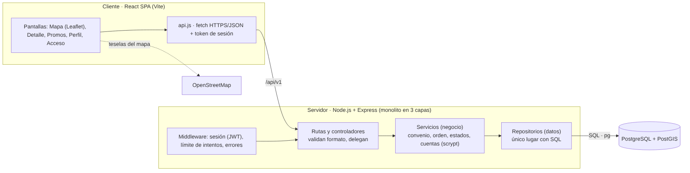
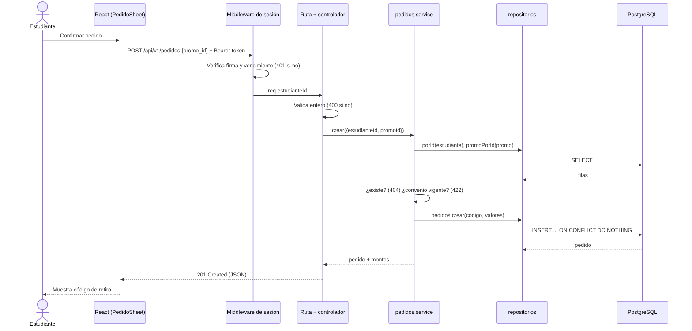
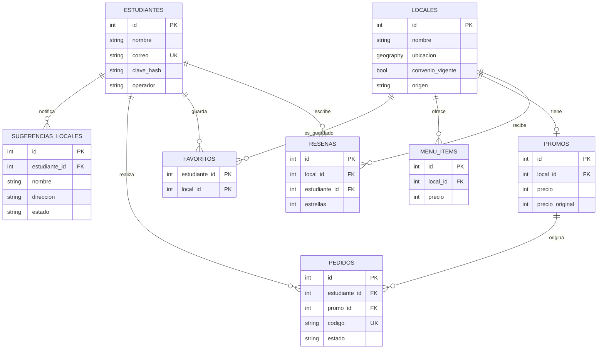

## 1. Introducción

En el Hito 1 JunaMap fue una promesa: un mapa único con los locales con convenio BAES, ordenados por cercanía y con voz de estudiantes. Este documento describe el motor que la sostiene: una API REST en Node.js y Express (Express, s. f.), organizada en tres capas, que guarda sus datos en PostgreSQL con PostGIS.

Cómo leerlo: la sección 2 declara qué cambió respecto del Hito 1; la 3 es el contrato de la API; la 4 muestra las capas y el recorrido de una petición; la 5 el modelo de datos y las credenciales; la 6 justifica las tecnologías y la 7 defiende por qué el servidor es un monolito.

## 2. Cambios respecto del Hito 1

Tabla 1. Qué se movió desde el Hito 1, por qué y con qué impacto.

| Qué decía el Hito 1 | Qué hicimos | Por qué | Impacto |
|---|---|---|---|
| La ruta era `GET /api/locales?lat&lng&radio` | Ahora es `GET /api/v1/locales` | El criterio de diseño de la API exige versionado; poner la versión en la ruta permite cambiar el contrato sin romper al cliente | El cliente usa `/api/v1` como base |
| Acceso a datos con un ORM «por ejemplo, Prisma» | Usamos `pg` con SQL parametrizado | La búsqueda por distancia usa `ST_DWithin` de PostGIS; con un ORM habría que escribir SQL crudo igual para esa consulta | Más SQL escrito a mano, que queda aislado en la capa de repositorios |
| El orden por cercanía y calificación lo decide la capa de negocio | Se mantiene: el servicio ordena; el repositorio solo filtra por radio | Respeta la regla «ninguna capa mezcla responsabilidades» | Ninguno |
| Costo de servicio de $250 por pedido (supuesto) | Es la variable `COSTO_SERVICIO` | El monto no está validado; no debe estar fijo en el código | Cambiarlo no exige tocar código |
| Panel del comercio (B2B), «aún no está en el prototipo» | Se expone el CRUD de locales (`POST`, `PUT`, `DELETE`) como base del panel; no hay interfaz | Es el recurso que un local necesitará administrar | Al cerrar este hito no había autenticación; en el Hito 3 se agregaron cuentas, pero estos endpoints siguen abiertos (limitación declarada) |
| El prototipo identificaba los locales con texto (`rosa`) | Ahora son enteros autoincrementales | Son claves de base de datos | El cliente deja de depender de datos fijos |
| Pregunta abierta: de dónde sale el catálogo de locales | En este hito, `seed.sql` y el CRUD de locales | Decidir la fuente real excedía el alcance del servidor | La pregunta quedó abierta y se resolvió en el Hito 3 con un listado propio de locales y un importador (ver documento del Hito 3) |

## 3. Diseño de la API REST

La API expone cinco recursos: locales (con su menú y su promo), reseñas, pedidos, estudiantes y favoritos. Tabla 2 es el contrato completo; `*` marca parámetros obligatorios. Los códigos de estado siguen el significado definido para HTTP (MDN Web Docs, s. f.): 2xx éxito, 400 formato inválido, 401/403 sesión o permiso, 404 recurso inexistente, 409 conflicto de estado, 422 regla de negocio y 429 límite de intentos.

Tabla 2. Contrato de la API (rutas, verbos, parámetros y códigos de estado).

{{api}}

## 4. Separación en capas

Figura 1. Arquitectura final del servidor.

La regla se escribió antes que el código: **el controlador no tiene lógica de negocio y las consultas SQL viven solo en los repositorios**. Es la separación de responsabilidades que describe la bibliografía del curso (Pressman, 2009; Vara Mesa et al., 2015).

Tabla 3. Qué archivo corresponde a cada capa.

| Capa | Carpeta y archivos | Hace | No hace |
|---|---|---|---|
| Rutas y controladores | `server/src/routes/`, `controllers/`, `middleware/validators.js` | Recibe la petición, valida formato y tipos (400) y delega | No calcula distancias ni arma SQL |
| Negocio | `server/src/services/*.service.js` | Convenio vigente, radio por defecto, orden, costo de servicio, transiciones de estado del pedido | No conoce HTTP ni SQL |
| Acceso a datos | `server/src/repositories/*.repo.js` | Ejecuta SQL parametrizado, incluidas las consultas espaciales y las transacciones | No aplica reglas de negocio |
| Composición | `server/src/app.js` | Conecta repositorios, servicios y controladores | Es el único archivo que conoce las tres capas |

Los servicios reciben sus repositorios como parámetros (`crearPedidosService({ pedidosRepo, ... })`). Gracias a eso se probaron las reglas de negocio sin base de datos, con repositorios simulados.

**Recorrido de una petición: crear un pedido** (versión final, con la sesión agregada en el Hito 3).

Figura 2. De la pantalla a la base de datos y de vuelta.

1. El cliente envía `POST /api/v1/pedidos` con `promo_id` y el token de sesión (`Authorization: Bearer ...`); el estudiante se obtiene del token, no del cuerpo.
2. El middleware de sesión verifica la firma y el vencimiento del token (401 si no son válidos) y el controlador comprueba que `promo_id` sea un entero positivo; si no, responde 400.
3. El servicio verifica que existan el estudiante (404) y la promo (404), y que el local tenga convenio vigente (422).
4. El servicio genera el código `JM-xxxx` y pide al repositorio insertarlo; si el código ya existe, el repositorio devuelve nulo y el servicio reintenta hasta cinco veces (503 si no lo logra).
5. El repositorio ejecuta `INSERT ... ON CONFLICT DO NOTHING` y devuelve la fila.
6. La respuesta sube como `201` con el código y los dos montos: lo que se paga en la app (costo de servicio) y lo que se paga en el local (promo).

## 5. Persistencia y credenciales

Figura 3. Modelo de datos.

El modelo está en `db/schema.sql` (crea todo desde cero, con claves, relaciones y restricciones `CHECK`) y los datos ficticios en `db/seed.sql`. La ubicación de cada local es una columna `GEOGRAPHY(Point, 4326)` con índice GiST, lo que permite buscar por distancia en metros con `ST_DWithin` (PostGIS, s. f.). El motor es PostgreSQL (PostgreSQL Global Development Group, s. f.). Los pedidos guardan una copia del nombre del local y de la promo, para conservar el historial aunque el local cambie o desaparezca.

**Credenciales.** La cadena de conexión y el costo de servicio se leen de variables de entorno (`server/.env`). El repositorio solo contiene `server/.env.example`, sin datos reales; `.gitignore` excluye `.env`. Si alguna vez se sube una credencial, se debe rotar, no solo borrar del código.

## 6. Tecnologías y su costo

Tabla 4. Decisiones del servidor, con alternativa comparada y desventaja asumida.

| Decisión | Alternativa | Criterios | Costo que asumimos |
|---|---|---|---|
| Node.js (JavaScript) | Python con Django | Un solo lenguaje en cliente y servidor (curva de aprendizaje), comunidad y costo (ambos gratuitos) | No trae ORM ni panel de administración |
| Express 4 | Fastify | Madurez, cantidad de documentación y conocimiento previo del equipo | Rendimiento algo menor y validación manual en lugar de esquemas integrados |
| `pg` con SQL | ORM (Prisma) | Soporte de PostGIS, transparencia de las consultas (el cliente es `node-postgres`; node-postgres, s. f.) | SQL escrito a mano; se mitiga con consultas parametrizadas |
| PostgreSQL + PostGIS | MongoDB | Soporte geoespacial nativo, integridad relacional | Esquema más rígido |

## 7. ¿Monolito o servicios distribuidos?

**Postura: monolito modular.** Un solo proceso Express con cuatro módulos (locales, reseñas, pedidos, estudiantes) separados por capas.

- **Carga esperada:** un piloto en una sede, con del orden de decenas de locales y un pico a la hora de almuerzo. Es un supuesto de trabajo, no una medición: aún no hay usuarios reales.
- **Tamaño del equipo:** Dos a tres personas. Varios servicios exigen coordinación de contratos, despliegues y fallas de red que el equipo no puede absorber en un semestre.
- **Costo de operación:** un servicio y una base de datos, frente a varios servicios, balanceador y mensajería.
- **Complejidad de despliegue:** un único proceso se levanta con `npm start`.
- **Consistencia:** crear un pedido toca estudiante, promo y pedido; en un monolito basta una consulta, en servicios separados habría que coordinar transacciones distribuidas.

**Cuándo revisaríamos la decisión:** si JunaMap operara en varias universidades con picos que obliguen a escalar los pedidos por separado, si otro equipo mantuviera el módulo de locales o si el panel del comercio pidiera ciclos de despliegue distintos. La separación en capas y módulos deja preparado ese corte.

## 8. Pruebas

La capa de negocio y las validaciones tenían 14 pruebas automáticas al cerrar este hito; hoy son 25, tras agregar las de cuentas y administración (`cd server && npm test`, con el ejecutor de pruebas integrado de Node.js; Node.js, s. f.) que cubren: radio por defecto, solo convenios vigentes, orden por cercanía y por calificación, regla de la promo, cobro dividido, reintento de código, transiciones de estado inválidas y validaciones de entrada. La colección `docs/junamap.postman_collection.json` reúne las peticiones de la demostración, en orden: iniciar sesión (guarda el token), leer, crear, actualizar y borrar un local, crear, listar y actualizar un pedido, y tres casos de error (400, 404 y 409). Se importa en Postman y se ejecuta contra el servidor levantado, con la variable `base` apuntando a `http://localhost:3000/api/v1` y `admin_key` con el valor de `ADMIN_KEY`. La demostración en sala se hace en vivo con esas mismas peticiones.

## 9. Conclusión

Qué se logró: una API con cinco recursos y operaciones completas, tres capas con responsabilidades separadas, datos persistentes con búsqueda espacial, credenciales fuera del repositorio y una decisión de arquitectura defendida con criterios propios. Qué quedó pendiente (la autenticación se resolvió después, en el Hito 3): la fuente real del catálogo de locales y la conexión de la interfaz, que es el objetivo del Hito 3. Qué aprendimos: que escribir la regla de capas antes del código evita que el SQL se cuele en los controladores; que inyectar los repositorios en los servicios permite probar las reglas de negocio sin base de datos; y que versionar la ruta desde el principio cuesta poco y evita romper al cliente cuando el contrato cambia.

## 10. Bibliografía

- Express. (s. f.). *Express: Fast, unopinionated, minimalist web framework for Node.js*. https://expressjs.com/
- node-postgres. (s. f.). *node-postgres documentation*. https://node-postgres.com/
- PostGIS. (s. f.). *ST_DWithin*. https://postgis.net/docs/ST_DWithin.html
- PostgreSQL Global Development Group. (s. f.). *PostgreSQL documentation*. https://www.postgresql.org/docs/
- MDN Web Docs. (s. f.). *HTTP response status codes*. https://developer.mozilla.org/en-US/docs/Web/HTTP/Status
- Node.js. (s. f.). *Test runner*. https://nodejs.org/api/test.html
- Pressman, R. S. (2009). *Ingeniería de software, un enfoque práctico*. McGraw Hill.
- Vara Mesa, J. M., Verde Marín, J. y López Sanz, M. (2015). *Desarrollo web en entorno servidor*. RA-MA Editorial.

## Anexo A. Declaración de uso de inteligencia artificial

| Herramienta | Para qué se usó | Cómo se verificó |
|---|---|---|
| Claude (Anthropic) | Borrador del servidor, del esquema SQL y de este documento | Pruebas automáticas de la capa de negocio; revisión del código por el equipo; ejecución de las peticiones de la colección contra el servidor local |

Cada integrante debe poder explicar cualquier archivo del servidor. Lo que no coincidía con el código real al comparar los documentos con el repositorio (por ejemplo, el número de pruebas o los campos de una petición) se corrigió a mano.
