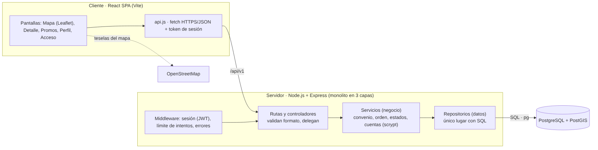
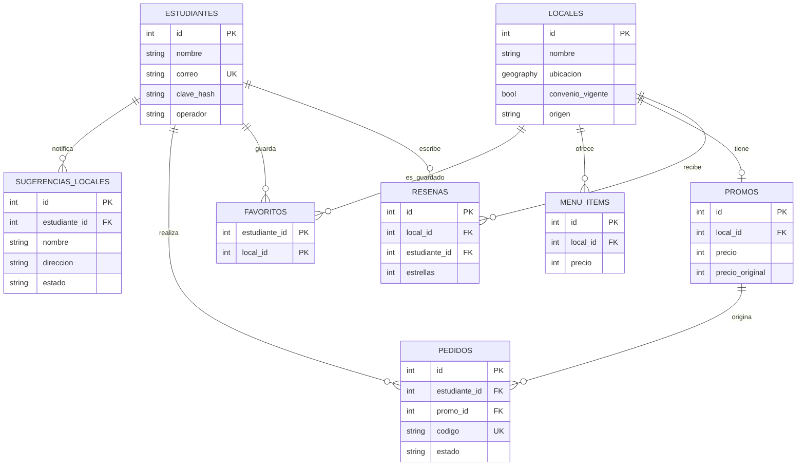
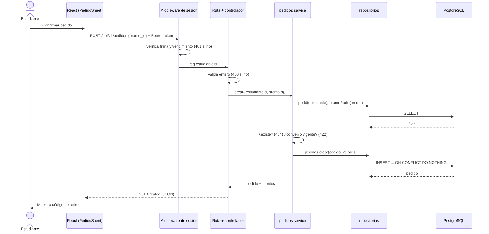

## 1. Introducción

JunaMap quiere responder rápido una pregunta diaria: ¿dónde como hoy, cerca y con mi beca? Este documento describe el producto tal como quedó construido: una aplicación React (React, s. f.) conectada a una API REST en tres capas y a una base PostgreSQL con PostGIS. Responde a un problema real: la BAES llega a unos 700 mil estudiantes de educación superior y solo se puede usar en locales con convenio (24horas, 2025), pero no existe un lugar único donde ver cuáles quedan cerca. Describe lo que existe, con sus limitaciones declaradas, incluida la gestión de cuentas de usuario y de datos personales.

## 2. Estado final del producto

El mapa, los locales y las promos se pueden explorar sin cuenta. Para guardar favoritos, pedir con promo o publicar reseñas hay que iniciar sesión o crear una cuenta. El flujo principal se recorre así:

1. **Mapa:** muestra un mapa real (OpenStreetMap contributors, s. f.) con los locales de la zona visible. La lista y los pines se actualizan a medida que el estudiante mueve el mapa; parte desde su ubicación, con permiso del navegador, o desde un punto de referencia si lo niega. Los filtros son «Más cerca», «Mejor calificados» y «Menú del día». Las cadenas conocidas muestran su logo.
2. **Cuenta:** el estudiante se registra con nombre, carrera, operador de su beca (Pluxee o Edenred), correo y contraseña, o inicia sesión.
3. **Detalle:** carga el local, su menú y sus reseñas; con sesión puede guardarlo en favoritos y publicar una reseña, que queda firmada con su nombre corto y su carrera.
4. **Pedido:** «Pedir con promo» crea el pedido a nombre del estudiante autenticado, y el servidor devuelve el código de retiro.
5. **Perfil:** lista sus pedidos, permite marcarlos como retirados o anularlos, y cambiar el operador.
6. **Notificar un local:** con sesión, desde el mapa el estudiante envía el nombre y la dirección de un local que acepta la BAES. La sugerencia queda «pendiente» en la base de datos y no aparece en el mapa hasta que se revise.

Los datos viven en PostgreSQL: al recargar la página, los pedidos, las reseñas y los favoritos siguen ahí.

Tabla 1. Qué está construido y qué no.

| Función | Estado |
|---|---|
| Mapa real (Leaflet + OpenStreetMap) que carga los locales de la zona visible | Construido |
| Ubicación del dispositivo, con permiso | Construido; si se niega, se usa un punto de referencia |
| Catálogo de locales cargado desde un listado propio con direcciones geocodificadas | Construido; el convenio de cada local no está verificado individualmente |
| Importador de sucursales de supermercados (OpenStreetMap) | Construido |
| Logos de cadenas conocidas | Construido |
| Cuentas: registro, inicio de sesión y sesión por token | Construido |
| Reseñas (crear, editar, borrar solo las propias), favoritos y pedidos asociados a la cuenta | Construido |
| Selector de operador | Construido |
| Panel del comercio (interfaz) | No construido; el CRUD de locales existe en la API y está protegido con una clave de administrador |
| Aviso de privacidad con consentimiento al registrarse | Construido |
| Borrado de cuenta por el propio usuario | Construido (borra la cuenta, sus reseñas, pedidos y favoritos) |
| Recuperación de contraseña y verificación de correo | No construido |
| Marcado de ítems compatibles con las reglas de la beca | No construido |

## 3. Arquitectura final

Figura 1. Arquitectura final.

El cliente (`client/`, construido con Vite; Vite, s. f.) tiene una pantalla por sección del árbol de información (Pérez-Montoro Gutiérrez, 2010) (mapa, detalle, promos, perfil y acceso), un módulo `api.js` que concentra las llamadas HTTP y adjunta el token de sesión, y un componente común que muestra los estados de carga, vacío y error. El servidor (`server/`, Node.js con Express; Express, s. f.) mantiene la separación en tres capas: rutas y controladores, servicios y repositorios (Pressman, 2009). Las cuentas se resuelven sin librerías adicionales, con el módulo `crypto` de Node (Node.js, s. f.): contraseñas con hash scrypt y sal aleatoria, y sesiones con un token firmado (JWT HS256) que vence a los 7 días. Un middleware exige el token en las rutas privadas y otro limita los intentos de ingreso. La presentación no contiene reglas de negocio ni SQL: el orden por cercanía, la validación del convenio, el cobro dividido y la pertenencia de cada pedido o reseña viven en los servicios.

Figura 2. Modelo de datos final.

Figura 3. Recorrido de «crear un pedido» a través de las capas, con validación de sesión.

## 4. Validación, errores y estados

- **En el cliente:** la reseña exige al menos 5 caracteres antes de enviarse; los botones se deshabilitan mientras se envía.
- **En el servidor:** cada controlador valida tipos y rangos (400); los servicios aplican reglas de negocio (404, 409, 422). Las rutas privadas responden 401 sin sesión válida y 403 si se intenta acceder a datos de otra persona; el ingreso responde con el mismo mensaje tanto si el correo no existe como si la contraseña es incorrecta, y devuelve 429 tras demasiados intentos. Todas las respuestas de error traen un mensaje en lenguaje de usuario.
- **En la interfaz:** cada lista muestra «Cargando…», un mensaje con botón «Reintentar» si falla la llamada, o un mensaje de lista vacía.

## 5. Bitácora de decisiones

Tabla 2. Decisiones, alternativas, motivo y qué salió mal.

| Fecha | Decisión | Alternativas | Motivo | Qué salió mal / cómo se resolvió |
|---|---|---|---|---|
| Hito 2 · octubre 2026 | Versionar la API en la ruta (`/api/v1`) | Versionar por cabecera | Más simple de probar y de documentar | El prototipo del Hito 1 usaba `/api/locales`; hubo que cambiar la base de las llamadas del cliente (`api.js`) |
| Hito 2 · octubre 2026 | SQL con `pg` en lugar de un ORM | Prisma | La consulta espacial usa funciones de PostGIS (PostGIS, s. f.) | Hay que escribir el SQL a mano; se aisló en `repositories/` y se parametrizó |
| Hito 2 · octubre 2026 | Monolito modular | Servicios separados | Equipo pequeño y un semestre | Sin incidentes: la separación en capas permitió probar los servicios con repositorios simulados |
| Hito 3 · noviembre 2026 | Mapa con Leaflet y OpenStreetMap | Google Maps API (previsto en el Hito 1) | No exige clave ni tarjeta y es gratuito | Los servidores públicos de teselas de OSM tienen condiciones de uso: sirven para esta demostración, no para tráfico masivo |
| Hito 2 · octubre 2026 | Cobro en dos partes: servicio en la app, promo en el local | Cobrar todo en la app | JunaMap no puede cobrar con el saldo de la beca | El costo de servicio ($250) es un supuesto sin validar; se dejó como variable de entorno (`COSTO_SERVICIO`) |
| Hito 3 · noviembre 2026 | Cuentas con hash scrypt y sesión por JWT firmado con `crypto` de Node | Librerías (bcrypt, jsonwebtoken); sesiones en servidor | Sin dependencias nuevas y con control del algoritmo | Al cerrar el Hito 2 las rutas de pedidos y estudiantes eran abiertas (cualquiera podía operar con cualquier id); se agregaron la sesión y la regla de que cada persona accede solo a lo suyo. El límite de intentos vive en memoria |
| Hito 3 · noviembre 2026 | Cargar locales desde un listado propio, geocodificando las direcciones con Nominatim (Nominatim, s. f.) | Consultar el buscador oficial de forma automática | No hay descarga pública del padrón y extraerlo podría violar sus términos de uso | Algunas direcciones sin número solo se ubican de forma aproximada; se guarda un caché de las consultas para no repetirlas |
| Hito 3 · noviembre 2026 | Cargar los locales de la zona visible del mapa | Búsqueda por radio fijo | La exploración se siente más natural | Con cientos de locales cargados hace falta un tope: la API devuelve como máximo 300 por consulta, los más cercanos al centro del mapa |

Cambios desde el Hito 1: se agregó el versionado de la API, se reemplazó el ORM previsto por SQL parametrizado, el mapa pasó de Google Maps a OpenStreetMap con Leaflet y el catálogo de locales pasó a ser una tabla administrable por CRUD y alimentada por un listado propio; además se incorporaron cuentas de usuario, que en el Hito 1 no estaban previstas. El detalle del Hito 2 está en su propio documento.

## 6. Pruebas y reproducibilidad

El servidor tiene 29 pruebas automáticas sobre la capa de negocio, las validaciones y la autenticación (`npm test`): incluyen el hash de contraseñas, la firma y expiración del token y las reglas de pedidos. El proyecto se levanta siguiendo el manual (`docs/manual.md`); la base de datos puede crearse con `docker compose up -d`. El manual se escribió a partir de la instalación en el equipo del grupo; los pasos más propensos a requerir ajustes son la importación de locales (secciones 7 y 8 del manual), que necesita internet. Para la presentación el producto se expuso con un túnel HTTPS temporal desde el equipo del grupo, sin despliegue permanente, y se probó desde otros dispositivos con el túnel activo: el flujo principal (mapa, cuenta, detalle, pedido y perfil) se recorrió desde un equipo distinto al que corre el servidor.

## 7. Limitaciones

- No hay recuperación de contraseña ni verificación del correo: quien olvide su clave no puede recuperarla, y se puede registrar un correo ajeno.
- La sesión se guarda en el navegador (`localStorage`); si la página sufriera una falla de seguridad que permita ejecutar código ajeno (XSS), el token podría robarse. El límite de intentos de ingreso vive en la memoria del servidor y se reinicia con él.
- La administración de locales (`POST`, `PUT`, `DELETE /locales`) se protege con una única clave de administrador compartida (cabecera `x-admin-key`), no con cuentas de comercio con roles; sirve para esta etapa, pero el panel del comercio necesitará cuentas propias. Sin la variable `ADMIN_KEY`, esas operaciones quedan desactivadas.
- Si no se configura `JWT_SECRET`, el servidor genera uno al arrancar y las sesiones se pierden al reiniciarlo.
- Los locales provienen de un listado del equipo con direcciones convertidas a coordenadas (algunas aproximadas, por calle) y de sucursales de cadenas citadas en prensa. Que una cadena esté adherida a la tarjeta Junaeb no garantiza que cada sucursal lo esté; la fuente oficial (los buscadores de Pluxee y Edenred) no está integrada, y la app no afirma que ningún comercio acepte la beca. Las cadenas provienen de lo que cita la prensa (Vásquez, 2026; Canal 13, s. f.).
- Los logos pertenecen a las marcas respectivas y se usan solo con fines académicos, sin implicar relación con ellas.
- Los precios, promos y reseñas de demostración son ficticios. Si el estudiante niega el permiso de ubicación, se usa un punto de referencia.
- Las sugerencias de locales solo se pueden listar con la clave de administrador (`GET /sugerencias`): todavía no hay pantalla de revisión ni forma de aprobarlas o rechazarlas, y no se verifica que el local exista.
- No hay pruebas automáticas de la interfaz ni de los repositorios contra una base real.

## 8. Conclusión

Qué se logró: un flujo completo desde la interfaz hasta la base de datos y de vuelta, con datos persistentes, validaciones y estados de error. Qué quedó pendiente: el control de acceso del panel del comercio con cuentas y roles, la recuperación de contraseña y la verificación del correo, la corrección de nombre y carrera desde la aplicación, la integración de la fuente oficial de locales con convenio y la validación con estudiantes de que decidir es el verdadero dolor. Qué aprendimos: que el contrato de la API definido en el Hito 2 permitió conectar la interfaz sin rehacer el servidor, pero que agregar cuentas obligó a tocar rutas, cliente y documentación a la vez; que los diagramas y las tablas se desfasan si no se actualizan junto con el código; y que cargar datos reales de locales, con direcciones y convenios que verificar, tomó más tiempo que programar la pantalla.

## 9. Bibliografía

- 24horas. (2025, 4 de marzo). *Junaeb confirma nueva alza de la beca BAES 2025: fecha de pago y monto*. https://www.24horas.cl/te-sirve/junaeb-nueva-alza-beca-baes-2025-fecha-pago-monto
- Vásquez, R. (2026, 19 de marzo). *¿Dónde aceptan la tarjeta Junaeb? Revisa los comercios asociados y las restricciones de la Beca BAES 2026*. Canal 13. https://www.13.cl/programas/noticias-13/servicios/donde-aceptan-la-tarjeta-junaeb-revisa-los-comercios-asociados-y
- React. (s. f.). *React documentation*. https://react.dev/
- Vite. (s. f.). *Vite guide*. https://vite.dev/guide/
- Express. (s. f.). *Express*. https://expressjs.com/
- PostGIS. (s. f.). *ST_DWithin*. https://postgis.net/docs/ST_DWithin.html
- Canal 13. (s. f.). *Tarjeta Junaeb: conoce los supermercados donde puedes usarla*. https://www.13.cl/programas/servicios-13/servicios/tarjeta-junaeb-conoce-los-supermercados-donde-puedes-usarla
- OpenStreetMap contributors. (s. f.). *OpenStreetMap*. https://www.openstreetmap.org/copyright
- Nominatim. (s. f.). *Nominatim documentation*. https://nominatim.org/release-docs/latest/
- Node.js. (s. f.). *Crypto*. https://nodejs.org/api/crypto.html
- Pérez-Montoro Gutiérrez, M. (2010). *Arquitectura de la información en entornos web*. Ediciones Trea.
- Pressman, R. S. (2009). *Ingeniería de software, un enfoque práctico*. McGraw Hill.

## Anexo A. Uso de inteligencia artificial

| Herramienta | Para qué se usó | Cómo se verificó |
|---|---|---|
| Claude (Anthropic) | Borrador del servidor, del esquema SQL, de la interfaz React y de la documentación | 29 pruebas automáticas, revisión del equipo y recorrido manual del flujo principal en el navegador |

Todo integrante debe poder explicar cualquier parte del código entregado. Lo que no coincidía con el código real al contrastar los documentos con el repositorio (cifras de pruebas, campos de peticiones, funciones listadas como pendientes que ya existían) se corrigió a mano.

## Anexo B. Análisis de datos personales (Ley 21.719)

Con las cuentas, JunaMap pasa a tratar datos personales de personas reales. Este análisis describe qué se trata, para qué, con qué protección y qué falta.

Tabla 3. Datos que trata el sistema.

| Dato | Finalidad | ¿Por qué es necesario? |
|---|---|---|
| Nombre y carrera | Mostrar el perfil y firmar reseñas (nombre corto y carrera) | Da contexto a la opinión; el nombre completo no se publica |
| Correo electrónico | Identificar la cuenta e iniciar sesión | Es el identificador de acceso |
| Contraseña | Autenticar | Se guarda solo como hash scrypt con sal; nunca en claro |
| Operador de la beca (Pluxee o Edenred) | Personalizar el perfil | Único dato de la beca que se usa |
| Pedidos (local, promo, código, estado) | Historial y retiro en el local | Es el servicio central |
| Favoritos y reseñas | Personalización y voz de estudiantes | Es la propuesta de valor |
| Ubicación del dispositivo | Calcular qué locales están cerca | Se pide con permiso del navegador, se envía solo para cada consulta y no se almacena |

**Minimización.** No se piden RUT, teléfono, número de tarjeta ni saldo de la beca, y la app lo declara en la pantalla de acceso. Las reseñas publican un nombre corto («Camila R.») y la carrera, no el correo.

**Medidas técnicas.** Contraseñas con scrypt y sal única; consentimiento explícito exigido por el servidor; comparaciones en tiempo constante; mensaje de error idéntico si el correo no existe o la clave es incorrecta; límite de intentos de ingreso y de registros por hora; tokens firmados con vencimiento de 7 días y secreto en variable de entorno; cada persona accede solo a sus pedidos, favoritos y reseñas; consultas SQL parametrizadas; credenciales fuera del repositorio. En desarrollo la aplicación se sirve por HTTP en `localhost`; para la presentación se expuso mediante un túnel de Cloudflare, que cifra la conexión con HTTPS. Una publicación permanente exigiría HTTPS (certificado en el servidor o en un proxy) para proteger la contraseña y el token en tránsito.

**Derechos del titular y eliminación.** El estudiante puede ver y cambiar su operador desde el perfil y eliminar su cuenta con un botón: la operación borra su cuenta, sus reseñas (texto y nombre visible), sus pedidos y sus favoritos en una sola transacción. Al registrarse debe marcar una casilla de consentimiento que explica qué datos se guardan y para qué, y el servidor rechaza el registro si no viene aceptada. Queda pendiente una vía para corregir el nombre o la carrera desde la aplicación y una política de privacidad extensa; por ahora solo existe el aviso breve con su casilla de consentimiento, y se declaran como mejoras futuras.

**Datos de prueba.** El repositorio y las demostraciones usan solo cuentas ficticias; no se cargan correos reales de terceros.
